<picture>
  <source media="(prefers-color-scheme: dark)" srcset="assets/head-dark.svg">
  
</picture>

I'm an AI and machine learning engineer in Cape Town. I solve problems with code, machine learning, statistics and AI, mostly for financial services firms, through my consultancy, Pallisade. My site argues the bull case and the bear case for hiring me, with the work behind each.

**[Read the bull and bear case](https://emil-fabel.vercel.app)** &nbsp;|&nbsp; [LinkedIn](https://www.linkedin.com/in/emil-fabel20040316) &nbsp;|&nbsp; [emil@fabelrsa.co.za](mailto:emil@fabelrsa.co.za)

<picture>
  <source media="(prefers-color-scheme: dark)" srcset="assets/chart-dark.svg">
  
</picture>
